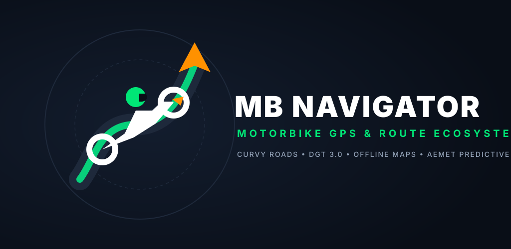

# MB-navigator

<p align="center">
  
</p>

> **MB Navigator** (*Motorbike Navigator*) es un ecosistema 100% Open Source diseñado específicamente para **rutas y navegación en moto**: búsqueda de carreteras con curvas (*curvy routing*), alertas meteorológicas críticas (viento lateral, riesgo de asfalto deslizante/hielo), tráfico en tiempo real con DGT 3.0 (balizas V16 y cortes), compatibilidad con Android Auto y editor multiplataforma de tracks.

---

## 📌 Visión del Proyecto

MB-navigator se compone de:

1. **MB Navigator (Android App)**: Navegador GPS para moto con mapas offline (PMTiles/MBTiles) y online (OSM), perfiles de ruteo para curvas y puertos de montaña con BRouter, guía de voz optimizada para intercomunicadores de casco (Cardo, Sena), alertas de radar y conexión con DGT 3.0.
2. **Route & Track Editor (Multiplataforma Flutter)**: Aplicación de escritorio y web para diseñar, inspeccionar perfiles altimétricos, calcular índices de curvas y exportar tracks en formatos estándar (GPX, KML, GeoJSON).
3. **Shared Core**: Esquemas canónicos de rutas, modelos de telemetría y algoritmos geográficos comunes.

---

## 🏗️ Metodología de Desarrollo

### 1. SDD (Specification-Driven Development)
Antes de implementar cualquier módulo o funcionalidad, se redacta su especificación técnica formal en `docs/specs/`. Las fases incluyen:
- Definición de requisitos funcionales y no funcionales.
- Contratos de datos y esquemas de intercambio (GPX/GeoJSON).
- Casos de prueba previstos antes de la implementación.

### 2. TDD (Test-Driven Development)
- Ciclo estricto: **Red -> Green -> Refactor**.
- Cobertura de pruebas unitarias para lógica de negocio, parsers y cálculos de distancia/elevación.
- Pruebas de integración con fuentes simuladas de telemetría GPS.

---

## 🌿 Flujo de Trabajo (Git Flow)

Seguimos el modelo Git Flow:
- `main`: Código en producción, etiquetas de versión (`vX.Y.Z`).
- `develop`: Rama principal de integración para el siguiente release.
- `feature/*`: Nuevas características nacidas de `develop`.
- `release/*`: Preparación de versiones candidatas (pruebas finales, versionado).
- `hotfix/*`: Correcciones críticas directas desde `main`.

---

## 💬 Conventional Commits

Los commits deben respetar el estándar de [Conventional Commits v1.0.0](https://www.conventionalcommits.org/en/v1.0.0/):

`<tipo>[ámbito opcional]: <descripción concisa>`

Tipos permitidos:
- `feat`: Nueva funcionalidad.
- `fix`: Corrección de errores.
- `docs`: Cambios en documentación o specs.
- `test`: Añadir o modificar tests (TDD).
- `refactor`: Refactorización de código sin cambio funcional.
- `ci`: Tareas de integración continua y despliegue.
- `chore`: Mantenimiento general, dependencias, etc.

---

## 📂 Estructura del Repositorio

```text
├── apps/
│   ├── android-navigator/    # App nativa Android (GPS / Navegación)
│   └── route-editor/         # App multiplataforma (Edición de rutas)
├── shared/                   # Lógica y modelos compartidos
├── docs/                     # Centro de documentación viva
│   ├── technical/            # Documentación técnica por aplicación y core
│   ├── user-guides/          # Guías y manuales de usuario final
│   ├── specs/                # Especificaciones SDD
│   ├── adr/                  # Architecture Decision Records
│   ├── release-guide.md      # Guía de firma y release en Play Store
│   └── README.md             # Índice general de documentación
├── .editorconfig
├── .gitignore
├── CONTRIBUTING.md
└── README.md
```

Para más detalles, consulta el [Índice de Documentación](docs/README.md).

